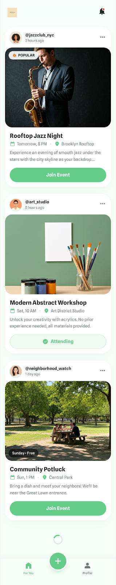
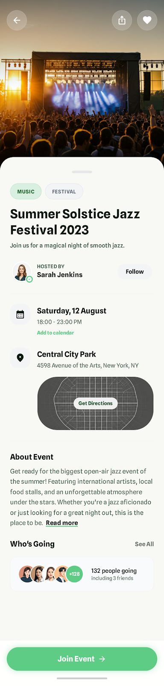
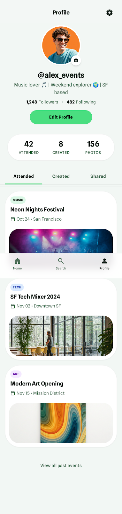
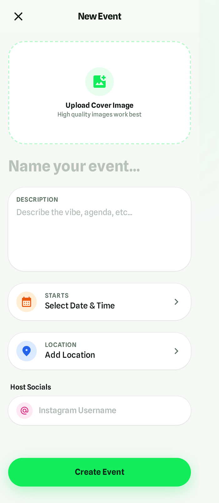
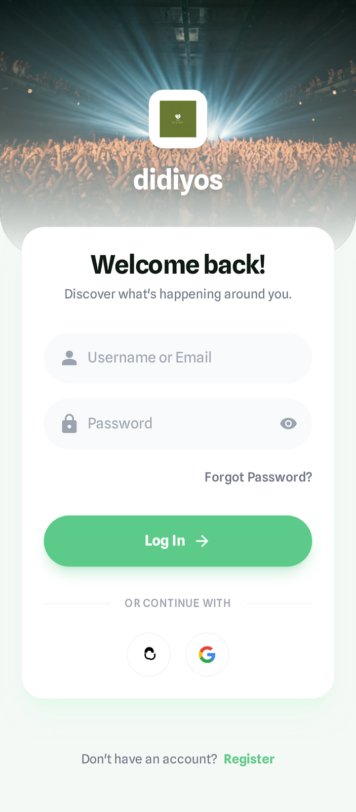
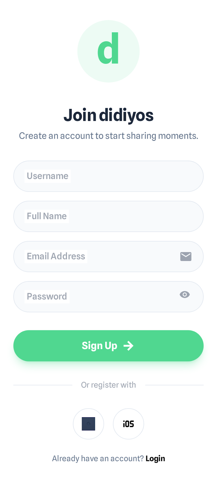
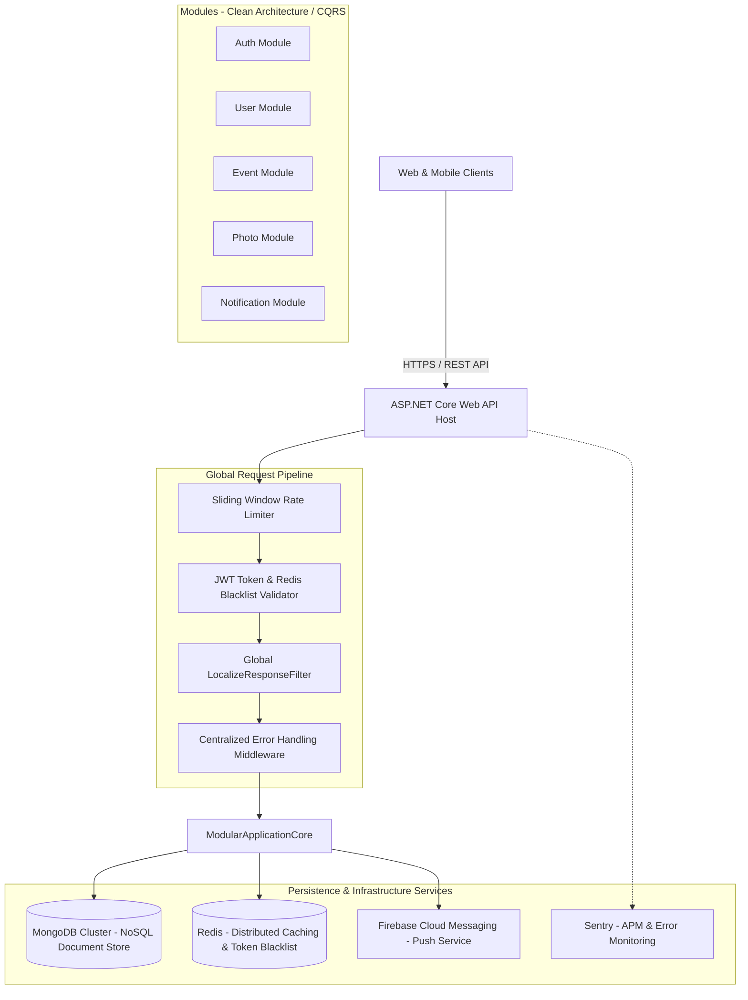
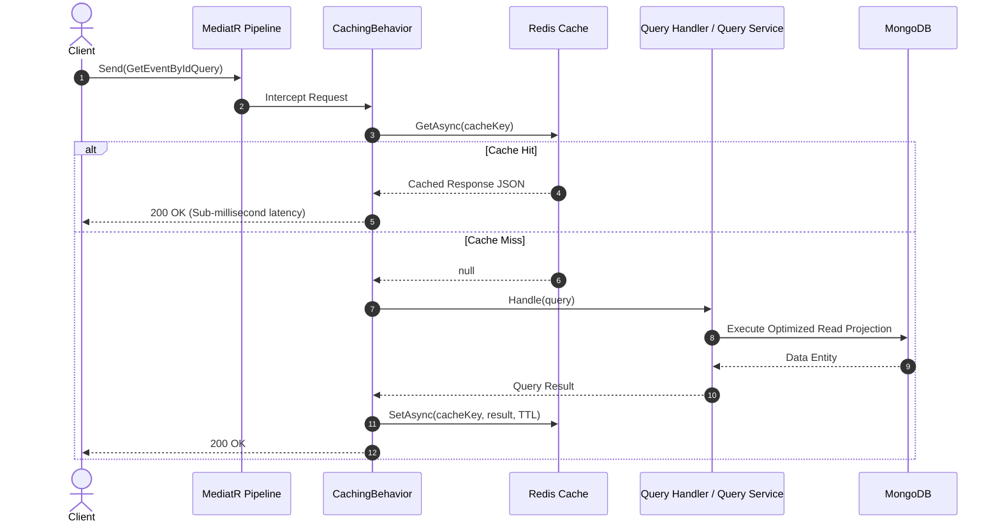
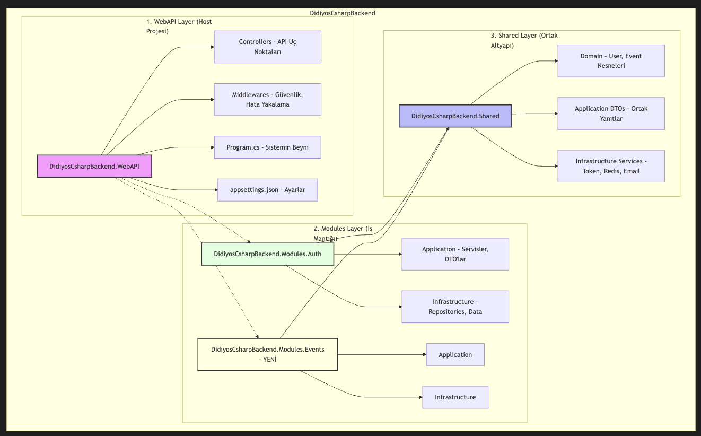

<div align="center">

  <h1>✨ Didiyos Backend — .NET 8 Modular Monolith</h1>
  <p><strong>A Highly Scalable, Clean-Architected Backend for Social Events & Photo Sharing Platforms</strong></p>

  <p>
    <a href="README.md"><strong>English</strong></a> •
    <a href="README.tr.md"><strong>Türkçe</strong></a>
  </p>

  <p>
    
    
    
    
    
    
    
    
  </p>

  <p>
    <em>This repository serves as the public <strong>architectural showcase & technical portfolio</strong> for the <strong>Didiyos</strong> backend platform. Core domain business logic and private codebases are securely retained in private repositories.</em>
  </p>

</div>

---

## 📌 Table of Contents
- [Overview](#-overview)
- [Client UI Showcase](#-client-ui-showcase)
- [System Architecture](#-system-architecture)
- [Core Engineering Highlights](#-core-engineering-highlights)
  - [1. CQRS & Automated Redis Pipeline Caching](#1-cqrs--automated-redis-pipeline-caching)
  - [2. Security: JWT & Distributed Token Blacklisting](#2-security-jwt--distributed-token-blacklisting)
  - [3. Domain-Driven Design (DDD) & Rich Domain Models](#3-domain-driven-design-ddd--rich-domain-models)
  - [4. Global Localization (i18n) Result Filter](#4-global-localization-i18n-result-filter)
  - [5. Sliding Window IP Rate Limiting](#5-sliding-window-ip-rate-limiting)
  - [6. Firebase Cloud Messaging (FCM) & In-Process Domain Events](#6-firebase-cloud-messaging-fcm--in-process-domain-events)
- [Modular Monolith Directory Layout](#-modular-monolith-directory-layout)
- [API & Swagger Endpoints](#-api--swagger-endpoints)
- [Testing & Quality Assurance](#-testing--quality-assurance)
- [Technology Stack](#-technology-stack)
- [Local Setup & Running](#-local-setup--running)

---

## 📖 Overview

**Didiyos** is an interactive social platform where users can organize events, capture and share memory albums, follow friends, and receive real-time push notifications.

The backend infrastructure is engineered to deliver low-latency responses under concurrent workloads, maintain strict domain boundaries, and ensure enterprise-grade security. It is built adhering to **Modular Monolith**, **Clean Architecture**, **CQRS (Command Query Responsibility Segregation)**, and **Domain-Driven Design (DDD)** principles.

---

## 📱 Client UI Showcase

Screenshots of the mobile and web client interfaces powered by the Didiyos C# backend:

| Event Feed & Discovery | Event Detail & Attendance |
|:---:|:---:|
|  |  |

| User Profile & Social Network | Create New Event Form |
|:---:|:---:|
|  |  |

| Secure Authentication (Login) | User Registration |
|:---:|:---:|
|  |  |

---

## 🏛 System Architecture

The application is structured as a **Modular Monolith**, ensuring loose coupling, high cohesion, and clear communication boundaries between business capabilities:



---

## ⚡ Core Engineering Highlights

### 1. CQRS & Automated Redis Pipeline Caching

Commands (state-mutating operations) and Queries (read operations) follow strict architectural isolation:

- **Queries (Automated Pipeline Caching):**  
  Application query handlers contain zero boilerplate caching code. Any query implementing the `ICacheableQuery` marker interface is automatically intercepted by MediatR's **`CachingBehavior<TRequest, TResponse>`**. The pipeline performs a cache lookup on Redis first; if missed, it executes the query via dedicated read-only Query Services and caches the result with a defined TTL.
- **Commands (Targeted Cache Invalidation):**  
  State modifications inject `IRedisService` directly into command handlers to invalidate specific cache keys immediately upon execution, ensuring real-time consistency.



---

### 2. Security: JWT & Distributed Token Blacklisting

Authentication utilizes JSON Web Tokens (JWT) signed with symmetric encryption. To support immediate session revocation (e.g., on `Logout` or security compromise), each token contains a unique `tokenId`.

Revoked token IDs are stored in Redis under `blacklist:{tokenId}`. The ASP.NET Core `JwtBearerEvents.OnTokenValidated` hook checks this blacklist on every authenticated request, returning **401 Unauthorized** for invalid sessions even if the token expiration date is still valid.

<div align="center">
  
  <p><em>Figure 1: Authentication, Token Lifecycle & Distributed Blacklist Architecture</em></p>
</div>

---

### 3. Domain-Driven Design (DDD) & Rich Domain Models

To avoid the pitfalls of Anemic Domain Models, all core business rules and state validations are encapsulated directly within **Rich Entities** and **Immutable Value Objects**:

- **Strict Encapsulation (`private set;`):** Entity properties cannot be modified arbitrarily from outside. State changes require explicit domain methods (`ValidateFollow`, `ValidateUnfollow`, `VerifyAndExtendRefreshToken`).
- **Immutable Value Objects:**
  - `EmailAddress`: Validates structure, trims/lowercases inputs, and verifies tokens (`ValidateVerification`).
  - `PasswordReset`: Enforces expiration checks and state updates for credential recovery.
  - `UserSession`: Manages token identification, refresh tokens, and lifetime policies.
- **Strongly Typed Exception Hierarchy:** Magic numbers in the application layer are replaced with typed HTTP exceptions (`NotFoundException` [404], `BadRequestException` [400], `ForbiddenException` [403], `ConflictException` [409], `UnauthorizedException` [401], `TooManyRequestsException` [429]).

---

### 4. Global Localization (i18n) Result Filter

The API supports 4 locales: `tr-TR`, `en-US`, `de-DE`, and `sv-SE`.

- **Decoupled Handlers:** Controllers and handlers do not reference `IStringLocalizer`. They return standardized translation keys.
- **Global `LocalizeResponseFilter`:** An ASP.NET Core Action/Result filter intercepts successful API responses and dynamically resolves message keys based on the incoming `Accept-Language` header before serializing the JSON payload.

---

### 5. Sliding Window IP Rate Limiting

To protect API endpoints from brute-force attempts and denial-of-service spikes:
- Utilizes ASP.NET Core's built-in **`PartitionedRateLimiter`** configured with a **Sliding Window** strategy.
- Limit: 100 requests per 1-minute window partitioned across 6 segments per client IP.
- Violations return an RFC-compliant `429 Too Many Requests` status with localized explanatory payloads.

---

### 6. Firebase Cloud Messaging (FCM) & In-Process Domain Events

Inter-module decoupling is achieved using MediatR in-process domain events:
- When a user follows another account, a `UserFollowedEvent` is published.
- The `Notification` module subscribes via `UserFollowedHandler` and dispatches real-time mobile push notifications using the Firebase Admin SDK asynchronously.

---

## 📂 Modular Monolith Directory Layout

The solution is divided into cohesive feature modules following Clean Architecture layers:

```text
DidiyosCsharpBackend/
├── DidiyosCsharpBackend.WebAPI/               # Host Application & API Gateway
│   ├── Controllers/                           # Lightweight HTTP Controllers
│   ├── Middlewares/                           # Error Handling, Localization, Rate Limiting
│   └── Program.cs                             # Composition Root & DI Registrations
│
├── DidiyosCsharpBackend.Modules.Auth/         # Identity & Authentication Module
│   ├── Application/                           # Commands, Handlers, DTOs, Token Services
│   └── Infrastructure/                        # Password Hashing, JWT Generation
│
├── DidiyosCsharpBackend.Modules.User/         # User Profiles & Social Graph Module
│   ├── Application/                           # Follow/Unfollow, Profile Updates
│   └── Infrastructure/                        # Mongo Repositories & UserQueryService
│
├── DidiyosCsharpBackend.Modules.Event/        # Event Management Module
│   ├── Application/                           # Event Creation, RSVP, Location Queries
│   └── Infrastructure/                        # EventQueryService & Spatial Mongo Indexing
│
├── DidiyosCsharpBackend.Modules.Photo/        # Photos & Media Module
│   ├── Application/                           # Photo Uploads, Reactions, Event Albums
│   └── Infrastructure/                        # PhotoRepository & PhotoQueryService
│
├── DidiyosCsharpBackend.Modules.Notification/ # Notification Dispatcher Module
│   └── Application/EventHandlers/             # MediatR In-Process Event Listeners (FCM)
│
├── DidiyosCsharpBackend.Shared/               # Core Shared Kernel
│   ├── Domain/Entities/                       # User & Shared Aggregate Roots
│   ├── Domain/ValueObjects/                   # EmailAddress, PasswordReset, UserSession
│   ├── Application/Behaviors/                 # CachingBehavior (Automatic Pipeline Cache)
│   └── Infrastructure/Services/               # RedisService, LocalStorageService
│
└── DidiyosCsharpBackend.Tests/                # Unit & Integration Test Suites
    ├── Modules/Auth/                          # Auth Command & Handler Tests
    ├── Modules/User/                          # Social Graph & Domain Model Tests
    └── Modules/Photo/                         # Media Upload & Query Service Tests
```

---

## 🔌 API & Swagger Endpoints

All endpoints are documented with OpenAPI specifications, supporting `Bearer` tokens and `Accept-Language` headers:

| Module | Method | Endpoint | Description |
|---|:---:|---|---|
| **Auth** | `POST` | `/api/auth/register` | Registers new user and sends verification email |
| **Auth** | `POST` | `/api/auth/login` | Issues access token and refresh token |
| **Auth** | `POST` | `/api/auth/refresh-token` | Rotates session tokens |
| **Auth** | `POST` | `/api/auth/logout` | Adds token to Redis blacklist and revokes session |
| **User** | `GET` | `/api/user/{id}` | Retrieves user profile with automated Redis caching |
| **User** | `PUT` | `/api/user/profile` | Updates personal details and bio |
| **User** | `POST` | `/api/user/{id}/follow` | Follows user and dispatches FCM notification |
| **Event** | `GET` | `/api/event/feed` | Retrieves personalized event discovery feed |
| **Event** | `POST` | `/api/event` | Creates a new social gathering event |
| **Photo** | `POST` | `/api/photo/upload` | Uploads photo to event gallery |
| **Photo** | `DELETE`| `/api/photo/{id}` | Deletes photo and cascades metadata updates |

---

## 🧪 Testing & Quality Assurance

Unit and integration test suites are written using **xUnit**, **Moq**, and **FluentAssertions** to ensure domain integrity and handler reliability:

```bash
# Execute test suite:
dotnet test DidiyosCsharpBackend.sln
```

```text
Test Execution Summary:
  Total Tests:  35
  Passed:       35
  Failed:       0
  Execution:    ~1.8s
```

---

## 🛠 Technology Stack

- **Runtime & Language:** .NET 8, C# 12
- **Architecture:** Modular Monolith, Clean Architecture, CQRS, DDD
- **Database:** MongoDB (Official C# Driver)
- **Cache & Token Store:** Redis (StackExchange.Redis)
- **Messaging & Pipelines:** MediatR (Pipeline Behaviors, In-Process Events)
- **Authentication:** JWT (JSON Web Tokens) with Redis Blacklist Revocation
- **Monitoring & APM:** Sentry SDK
- **Push Notifications:** Firebase Cloud Messaging (FCM Admin SDK)
- **Security:** ASP.NET Core Rate Limiter, CORS Policies
- **Documentation:** Swagger / OpenAPI (Swashbuckle)

---

## 🚀 Local Setup & Running

To explore or run the backend service locally:
- [.NET 8.0 SDK](https://dotnet.microsoft.com/download/dotnet/8.0)
- [Docker & Docker Compose](https://www.docker.com/)

### 1. Launch MongoDB & Redis
```bash
docker run -d --name didiyos-mongo -p 27017:27017 mongo:latest
docker run -d --name didiyos-redis -p 6379:6379 redis:latest
```

### 2. Build & Run Application
```bash
# Restore dependencies and build solution
dotnet restore DidiyosCsharpBackend.sln
dotnet build DidiyosCsharpBackend.sln

# Start Web API host
cd DidiyosCsharpBackend.WebAPI
dotnet run
```

### 3. Access Swagger UI
Open your browser and navigate to:
```text
https://localhost:7001/swagger
```

---

<div align="center">
  <sub>Didiyos Platform © 2026. All rights reserved. This repository is published strictly for architectural demonstration and portfolio purposes.</sub>
</div>