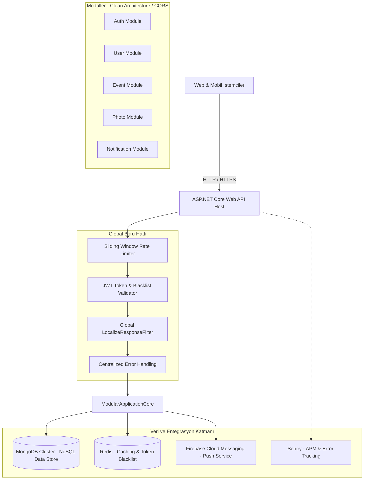
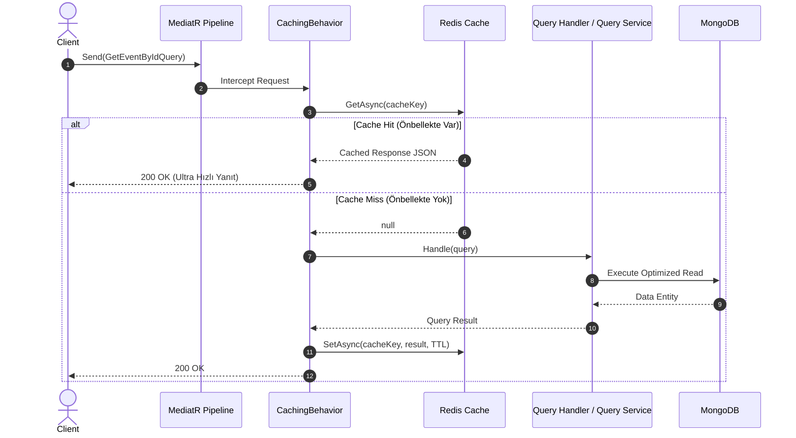

<div align="center">

  <h1>✨ Didiyos Backend — C# / .NET 8 Modular Monolith</h1>
  <p><strong>Modern, Scalable & High-Performance Social Event & Photo Sharing Platform Backend</strong></p>

  <p>
    
    
    
    
    
    
    
    
  </p>

  <p>
    <em>Bu repo, <strong>Didiyos</strong> projesinin kurumsal düzeyde tasarlanmış <strong>.NET 8 Backend</strong> mimarisinin halka açık mimari ve teknik sunumudur (Showcase / Architecture Portfolio). Çekirdek iş mantığı ve kaynak kodları özel (private) depoda korunmaktadır.</em>
  </p>

</div>

---

## 📌 İçindekiler
- [Hakkında (Overview)](#-hakkında-overview)
- [Arayüz & Kullanıcı Deneyimi (UI Showcase)](#-arayüz--kullanıcı-deneyimi-ui-showcase)
- [Sistem Mimarisi (Architecture)](#-sistem-mimarisi-architecture)
- [Temel Mühendislik & Tasarım Desenleri](#-temel-mühendislik--tasarım-desenleri)
  - [1. CQRS & Otomatik Redis Pipeline Önbellekleme](#1-cqrs--otomatik-redis-pipeline-önbellekleme)
  - [2. Güvenlik: JWT + Redis Token Blacklisting](#2-güvenlik-jwt--redis-token-blacklisting)
  - [3. Domain-Driven Design (DDD) & Zengin Domain Modelleri](#3-domain-driven-design-ddd--zengin-domain-modelleri)
  - [4. Çok Dilli (i18n) Global Result Filtresi](#4-çok-dilli-i18n-global-result-filtresi)
  - [5. Sliding Window Rate Limiter](#5-sliding-window-rate-limiter)
  - [6. Firebase Cloud Messaging (FCM) & Event Handlers](#6-firebase-cloud-messaging-fcm--event-handlers)
- [Modüler Monolit Yapısı](#-modüler-monolit-yapısı)
- [API & Swagger Uç Noktaları](#-api--swagger-uç-noktaları)
- [Test & Kalite Güvencesi](#-test--kalite-güvencesi)
- [Teknoloji Yığını (Tech Stack)](#-teknoloji-yığını-tech-stack)
- [Yerel Kurulum & Çalıştırma](#-yerel-kurulum--çalıştırma)

---

## 📖 Hakkında (Overview)

**Didiyos**, kullanıcıların etkinlikler oluşturabildiği, etkinliklere özel anı fotoğrafları paylaşabildiği, diğer kullanıcıları takip edip anlık bildirimler alabildiği kapsamlı bir sosyal etkinlik ve anı paylaşım platformudur.

Backend servisi, yüksek eşzamanlı istekleri en düşük gecikmeyle karşılamak, temiz kod pratiklerini korumak ve güvenliği en üst seviyede tutmak amacıyla **Modular Monolith**, **Clean Architecture**, **CQRS (Command Query Responsibility Segregation)** ve **Domain-Driven Design (DDD)** prensiplerine sadık kalınarak geliştirilmiştir.

---

## 📱 Arayüz & Kullanıcı Deneyimi (UI Showcase)

Backend servislerinin beslediği Didiyos platformuna ait temel mobil ve web arayüzleri:

| Keşfet & Etkinlik Akışı | Etkinlik Detayı & Katılım |
|:---:|:---:|
|  |  |

| Profil & Sosyal Etkileşim | Etkinlik Oluşturma Formu |
|:---:|:---:|
|  |  |

| Güvenli Giriş (Login) | Kullanıcı Kaydı (Register) |
|:---:|:---:|
|  |  |

---

## 🏛 Sistem Mimarisi (Architecture)

Proje; bağımsız işletilebilir modüllerden oluşan, gevşek bağlı (loosely coupled) ve yüksek uyumlu (high cohesion) bir **Modular Monolith** yapısında kurgulanmıştır.



---

## ⚡ Temel Mühendislik & Tasarım Desenleri

### 1. CQRS & Otomatik Redis Pipeline Önbellekleme
Mimaride sorgular (Queries) ve komutlar (Commands) kesin çizgilerle birbirinden ayrılmıştır:

- **Sorgular (Queries - Otomatik Cache):**  
  Handler'lar içinde tekrarlayan manuel cache kodları yazılmaz. `ICacheableQuery` arayüzünü uygulayan tüm sorgular, MediatR boru hattına entegre edilen **`CachingBehavior<TRequest, TResponse>`** tarafından yakalanır. Veri önce Redis'ten taranır, varsa doğrudan döner; yoksa veritabanından çekilip belirlenen TTL ile önbelleğe yazılır.
- **Komutlar (Commands - Hedefli Invalidation):**  
  Yazma, güncelleme veya silme işlemleri çalıştırıldığında `IRedisService` doğrudan enjekte edilerek ilgili iş kuralına ait anahtarlar anında temizlenir (Cache Invalidation).



---

### 2. Güvenlik: JWT + Redis Token Blacklisting
Sisteme giriş yapan kullanıcılara standart süreye sahip JWT erişim anahtarları verilir. Kullanıcı çıkış yaptığında (`Logout`) veya güvenlik ihlali tespit edildiğinde, JWT'ye gömülü benzersiz `tokenId` Redis üzerinde karalisteye (`blacklist:{tokenId}`) eklenir.

ASP.NET Core `JwtBearerEvents.OnTokenValidated` aşamasında Redis kontrolü yapılır; karalistedeki token'lar süresi dolmamış olsa bile anında **401 Unauthorized** ile reddedilir.

<div align="center">
  
  <p><em>Şekil 1: Kimlik Doğrulama, Token ve Güvenlik Akış Mimarisi</em></p>
</div>

---

### 3. Domain-Driven Design (DDD) & Zengin Domain Modelleri
Anemic Domain Model yaklaşımı yerine, tüm iş kurallarını kendi içerisinde doğrulayan **Rich Domain Entity** ve **Value Object** mimarisi uygulanmıştır:

- **Özel Alan Kapsülleme (Private Setters):** Varlık alanları doğrudan dışarıdan değiştirilemez; yalnızca varlık üzerindeki anlamlı metodlar (`ValidateFollow`, `ValidateUnfollow`, `VerifyAndExtendRefreshToken`) aracılığıyla güncellenir.
- **Değer Nesneleri (Value Objects):**
  - `EmailAddress`: E-posta format doğrulaması, onay jetonu (`VerificationToken`) ve süre kurallarını saklar.
  - `PasswordReset`: Şifre sıfırlama taleplerini ve geçerlilik sürelerini yönetir.
  - `UserSession`: Oturum anahtarları (`TokenId`, `RefreshToken`) ve oturum tazeleme kurallarını yönetir.
- **Özelleştirilmiş İstisna Hiyerarşisi:** Kod tabanında magic number (400, 401, 403, 404, 429) durum kodları yerine `NotFoundException`, `BadRequestException`, `ForbiddenException`, `ConflictException`, `UnauthorizedException` ve `TooManyRequestsException` gibi amaca yönelik istisnalar fırlatılır.

---

### 4. Çok Dilli (i18n) Global Result Filtresi
Sistem `tr-TR`, `en-US`, `de-DE` ve `sv-SE` olmak üzere 4 farklı dili destekler.
- `LocalizeResponseFilter`: Kontrolörler yanıt üretirken yerelleştirme servisine bağımlı olmak zorunda kalmaz; doğrudan standart çeviri anahtarlarını (Localization Keys) dönerler.
- Global Result Filter, istemcinin `Accept-Language` başlığına göre JSON yanıtlarındaki başarı ve bilgilendirme mesajlarını çalışma zamanında otomatik olarak ilgili dile çevirir.

---

### 5. Sliding Window Rate Limiter
Kötü niyetli istekleri ve brute-force saldırılarını engellemek amacıyla IP bazlı **Sliding Window Rate Limiter** uygulanmıştır:
- **Kapasite:** 1 dakikalık pencerede segmentlere ayrılmış 100 izin limiti.
- **Aşım Durumu:** Standart RFC formatında `429 Too Many Requests` yanıtı ve yerelleştirilmiş hata mesajı döner.

---

### 6. Firebase Cloud Messaging (FCM) & Event Handlers
Modüller arasındaki bağımlılığı en aza indirmek için MediatR Domain Event altyapısı kullanılır:
- Örneğin bir kullanıcı başka bir kullanıcıyı takip ettiğinde `UserFollowedEvent` tetiklenir.
- `Notification` modülündeki dinleyici (`UserFollowedHandler`), Firebase Admin SDK aracılığıyla hedef kullanıcının cihazına arka planda anlık bildirim (Push Notification) gönderir.

---

## 📂 Modüler Monolit Yapısı

Proje, Clean Architecture katmanlarını modül bazında organize eder:

```text
DidiyosCsharpBackend/
├── DidiyosCsharpBackend.WebAPI/               # Host & API Gateway Katmanı
│   ├── Controllers/                           # İnce (Thin) API Uç Noktaları
│   ├── Middlewares/                           # Error, RateLimit, Localization Middleware'leri
│   └── Program.cs                             # IoC, Pipeline & Modül Kayıtları
│
├── DidiyosCsharpBackend.Modules.Auth/         # Kimlik Doğrulama & Yetkilendirme Modülü
│   ├── Application/                           # Commands, Handlers, DTOs, Validations
│   └── Infrastructure/                        # Token Generator, Şifreleme Servisleri
│
├── DidiyosCsharpBackend.Modules.User/         # Kullanıcı Profili & Sosyal Ağ Modülü
│   ├── Application/                           # Takip/Takipten Çık, Profil Güncelleme
│   └── Infrastructure/                        # Mongo Repositories & UserQueryService
│
├── DidiyosCsharpBackend.Modules.Event/        # Etkinlik Yönetim Modülü
│   ├── Application/                           # Etkinlik Oluşturma, Katılma, Listeleme
│   └── Infrastructure/                        # EventQueryService & Mongo Veri Katmanı
│
├── DidiyosCsharpBackend.Modules.Photo/        # Fotoğraf & Gönderi Modülü
│   ├── Application/                           # Fotoğraf Yükleme, Beğeni, Etkinlik Albümü
│   └── Infrastructure/                        # PhotoRepository & PhotoQueryService
│
├── DidiyosCsharpBackend.Modules.Notification/ # Bildirim Modülü (FCM Entegrasyonu)
│   └── Application/EventHandlers/             # MediatR Entegrasyon Olay Dinleyicileri
│
├── DidiyosCsharpBackend.Shared/               # Çekirdek & Ortak Altyapı
│   ├── Domain/Entities/                       # User ve Paylaşılan Varlıklar
│   ├── Domain/ValueObjects/                   # EmailAddress, PasswordReset, UserSession
│   ├── Application/Behaviors/                 # CachingBehavior (Pipeline Cache)
│   └── Infrastructure/Services/               # RedisService, LocalStorageService
│
└── DidiyosCsharpBackend.Tests/                # Kapsamlı Birim & Entegrasyon Testleri
    ├── Modules/Auth/                          # Kimlik Doğrulama Testleri
    ├── Modules/User/                          # Kullanıcı Modülü Testleri
    └── Modules/Photo/                         # Fotoğraf Modülü Testleri
```

---

## 🔌 API & Swagger Uç Noktaları

Tüm API uç noktaları Swagger / OpenAPI üzerinde dokümante edilmiştir ve `Bearer Token` ile `Accept-Language` parametrelerini destekler.

| Modül | Metod | Uç Nokta | Açıklama |
|---|:---:|---|---|
| **Auth** | `POST` | `/api/auth/register` | Yeni kullanıcı kaydı oluşturur ve doğrulama e-postası tetikler |
| **Auth** | `POST` | `/api/auth/login` | JWT Erişim ve Yenileme (Refresh) jetonları üretir |
| **Auth** | `POST` | `/api/auth/refresh-token` | Oturumu yeniler |
| **Auth** | `POST` | `/api/auth/logout` | Token'ı Redis karalistesine alarak oturumu sonlandırır |
| **User** | `GET` | `/api/user/{id}` | Kullanıcı profil detaylarını getirir (Redis Önbellekli) |
| **User** | `PUT` | `/api/user/profile` | Profil bilgilerini ve biyografiyi günceller |
| **User** | `POST` | `/api/user/{id}/follow` | Belirtilen kullanıcıyı takibe alır (FCM Bildirimi tetikler) |
| **Event** | `GET` | `/api/event/feed` | Kullanıcıya özel ana akış etkinliklerini listeler |
| **Event** | `POST` | `/api/event` | Yeni bir sosyal etkinlik oluşturur |
| **Photo** | `POST` | `/api/photo/upload` | Etkinliğe anı fotoğrafı ekler |
| **Photo** | `DELETE`| `/api/photo/{id}` | Fotoğrafı ve ilişkili kayıtları siler |

---

## 🧪 Test & Kalite Güvencesi

Projede Domain kuralları, Command/Query Handler mantıkları ve entegrasyonlar **xUnit**, **Moq** ve **FluentAssertions** ile test edilmektedir.

```bash
# Tüm testleri çalıştırmak için:
dotnet test DidiyosCsharpBackend.sln
```

```text
Test Çalıştırma Özeti:
  Toplam Test: 35
  Başarılı:   35
  Başarısız:  0
  Geçen Süre: ~1.8 sn
```

---

## 🛠 Teknoloji Yığını (Tech Stack)

- **Platform & Dil:** .NET 8, C# 12
- **Mimari Yaklaşım:** Modular Monolith, Clean Architecture, CQRS, DDD
- **Veritabanı:** MongoDB (Official C# Driver)
- **Önbellek & Oturum:** Redis (StackExchange.Redis)
- **Mesajlaşma & Olaylar:** MediatR (Pipeline Behaviors, In-Process Events)
- **Yetkilendirme:** JWT (JSON Web Tokens) with Sliding Expiration & Redis Blacklist
- **Hata Takibi:** Sentry SDK
- **Bildirim:** Firebase Cloud Messaging (FCM Admin SDK)
- **Güvenlik & Hız:** ASP.NET Core Rate Limiter, CORS Policies
- **Dokümantasyon:** Swagger / OpenAPI with Swashbuckle

---

## 🚀 Yerel Kurulum & Çalıştırma

Showcase'i yerel ortamda çalıştırmak için aşağıdaki bağımlılıkların kurulu olması gerekir:
- [.NET 8.0 SDK](https://dotnet.microsoft.com/download/dotnet/8.0)
- [Docker & Docker Compose](https://www.docker.com/)

### 1. Veritabanı & Redis Servislerini Başlatın
```bash
# MongoDB ve Redis konteynerlerini ayağa kaldırın
docker run -d --name didiyos-mongo -p 27017:27017 mongo:latest
docker run -d --name didiyos-redis -p 6379:6379 redis:latest
```

### 2. Projeyi Derleyin ve Çalıştırın
```bash
# Bağımlılıkları geri yükleyin ve derleyin
dotnet restore DidiyosCsharpBackend.sln
dotnet build DidiyosCsharpBackend.sln

# Web API projesini başlatın
cd DidiyosCsharpBackend.WebAPI
dotnet run
```

### 3. Swagger Arayüzüne Erişin
Tarayıcınızdan aşağıdaki adresi açarak interaktif API dokümantasyonunu inceleyebilirsiniz:
```text
https://localhost:7001/swagger
```

---

<div align="center">
  <sub>Didiyos Platform © 2026. Tüm hakları saklıdır. Bu repository mimari ve teknik yetkinlik sunumu amacıyla paylaşılmıştır.</sub>
</div>